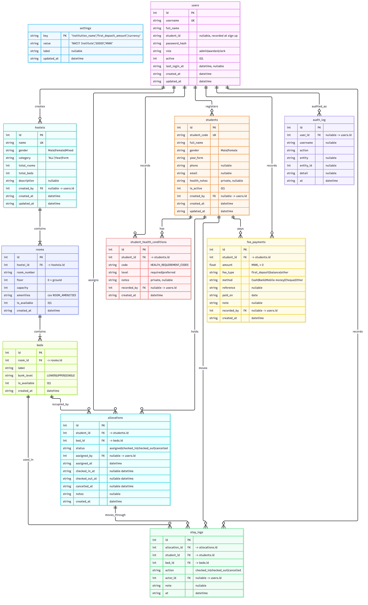
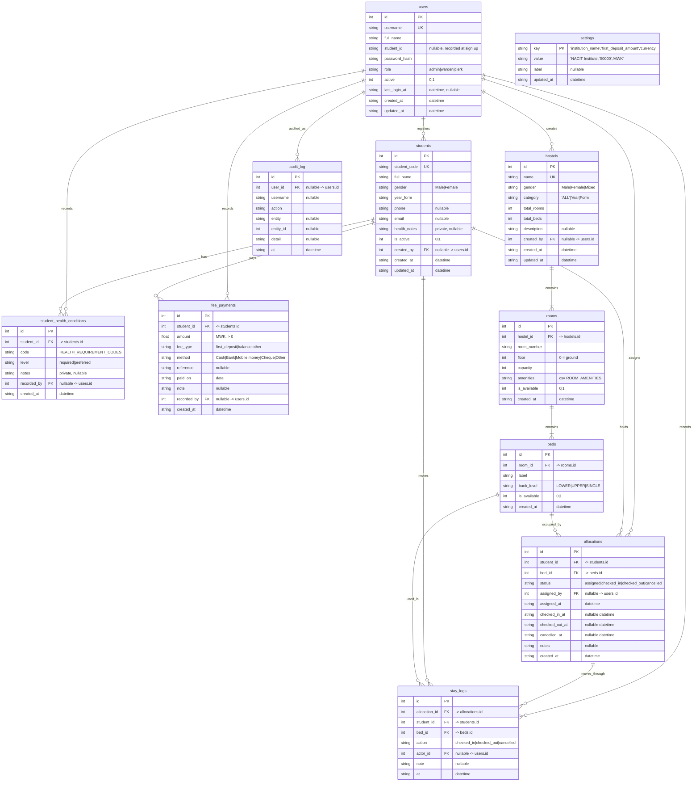
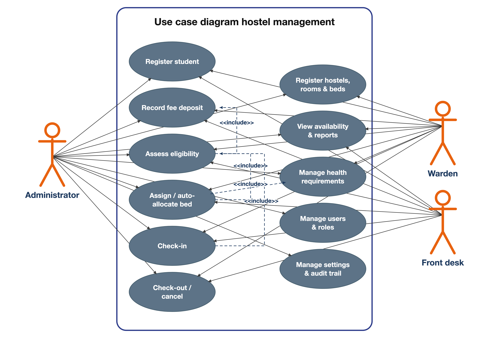
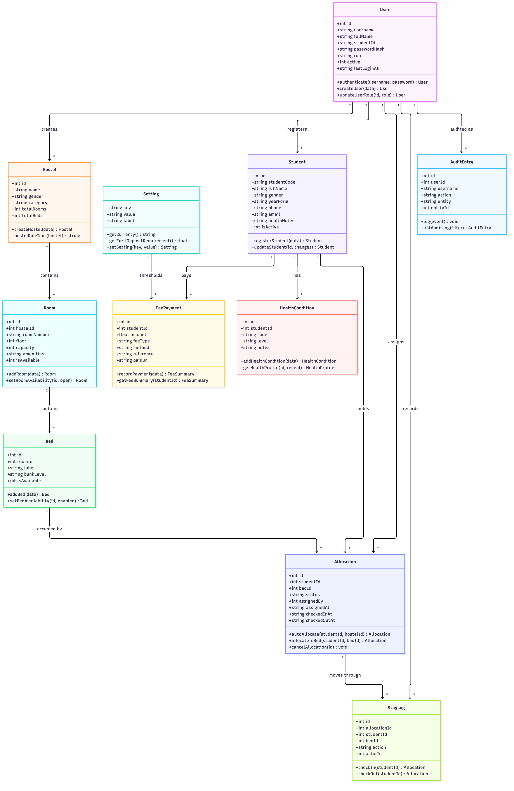
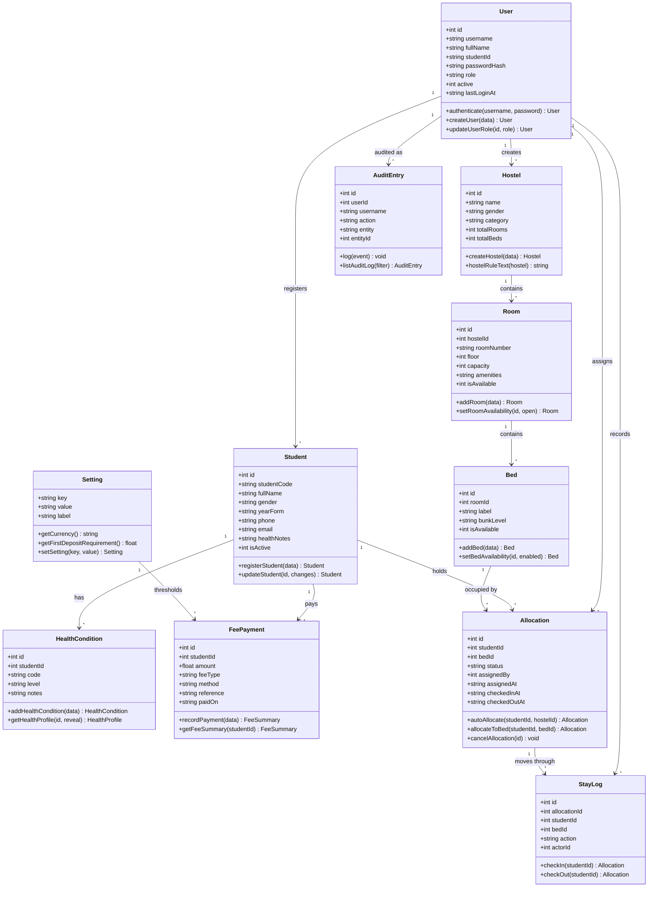

# Hostel Bed Allocation System

Design documentation for a system to manage bed allocation in a hostel.

## 1. System Requirements

### 1.1 Technical Requirements

**a. Languages / Stack**

- JavaScript
- Supabase / SQLite

> Flexible as it allows cross-platform support.

**b. Database Type**

- **Relational database** — allows answering documentational queries, e.g.:
  - Which student belongs to which room?
  - Number of students per room / hostel / etc.

**c. Supported Devices**

- Phones
- Laptops

### 1.2 User Requirements

a. **Fee registration** — at least first deposit required
b. **Student ID** — identity of payer, name, gender
c. **Hostel inventory** — names of hostels, number of rooms in each hostel, and number of beds
d. **Hostel categorization** — which hostels are male or female, for what year / form, or whatever separates them accordingly

### 1.3 Functional Requirements

a. Registering a student
b. Registering the hostels
c. Checking in
d. Checking out
e. Finding out availability
f. Assessing eligibility — whether students have paid
g. Assigning students to rooms — taking into consideration health and sensitivity issues

### 1.4 Legal & Ethical Requirements

- Keeping track of health conditions with privacy
- Protect data against unauthorized access (authentication)

## 2. Design Diagrams

### 2.1 ERD — Entity Relationship Diagram

Source of truth: `src/db/schema.sql` (SQLite). Amounts are printed in `MWK`
via `settings.currency`. `allocations` allows only one active
(`assigned`, `checked_in`) row per student and per bed (partial unique indexes).

### 2.2 Use Case Diagram

Shows how each user relates to their roles / functional requirements.
Roles and permissions: `src/security/roles.js`, `src/security/permissions.js`.
Functional requirements: §1.3 a–g. Dashed arrows are `<<include>>` dependencies.

> Source: `docs/diagrams/use-case-diagram.svg`, generated by
> `docs/diagrams/make_use_case.py` (classic UML style: actors outside the
> system boundary, `<<include>>` dashes between use cases).

| Actor | Use cases |
| --- | --- |
| Administrator | UC1–UC11 (all) |
| Warden | UC1–UC9 (no user/role or settings management) |
| Front desk (clerk) | UC1, UC3–UC8 (students, fees, allocation, stay, reports) |

Dependencies: UC4 includes UC3 · UC5 includes UC4, UC9 · UC6 includes UC4.

Self-service sign-up (`src/cli/session.js`) requires a Student ID, recorded on
`users.student_id` — covered by UC10.

### 2.3 Class Diagram

Keeps information and shows data types. Entity attributes mirror
`src/db/schema.sql` column types; service operations mirror `src/services/*.js`.
Money amounts are `REAL` in storage and formatted as `MWK` via `settings.currency`.

## 3. Contributors

| Role | Name | Email |
| ------ | ------ | ------- |
| Owner | Success | <successmwita22@gmail.com> |
| Contributor | AQUA SLOVIC | <aquaslovic@gmail.com> |
| Contributor | Muzika | <muzikamigochi129@gmail.com> |
| Contributor | Bleggo 7 | <bleggobandz@gmail.com> |
| Contributor | dnlmgwi | <pdmgawi@gmail.com> |

## 4. License

This project is licensed under the MIT License — see the [LICENSE](LICENSE) file for details.
